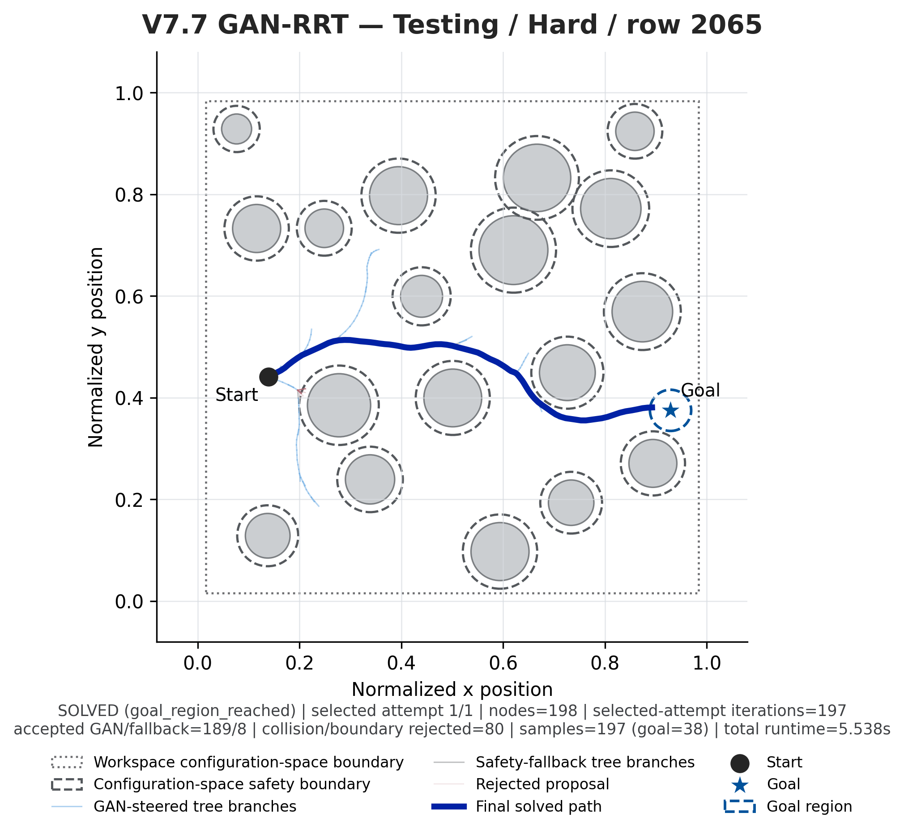
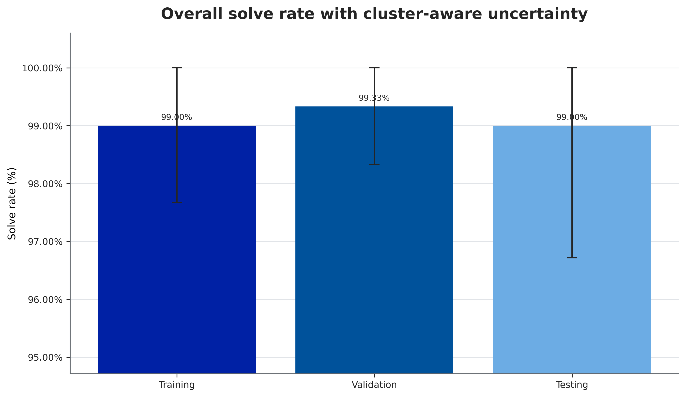

# A Learning-Based Generative Sampler for Basic RRT

**Saketh Tammisetti** · SCC Lab, UF Mechanical & Aerospace Engineering · PI: Dr. Rushikesh Kamalapurkar
University of Florida Student Science Training Program (SSTP) 2026

This repository contains the code, trained model, dataset, and full results behind my UF SSTP 2026 research poster ([`poster/SSTP_2026_Poster.pdf`](poster/SSTP_2026_Poster.pdf)).

---

## Overview

Rapidly-exploring Random Trees (RRTs) explore well, but simple geometric steering ignores velocity. An LQR–CBF (Linear Quadratic Regulator + Control Barrier Function) expert produces safe, dynamics-aware steps, but it needs an optimization at every tree expansion, which makes it too slow to repeat thousands of times.

**Research question:** Can a conditional generative model learn the expert's one-step steering transition, while the planner keeps everything else that makes RRT work (random sampling, nearest-parent selection, one-child growth, and independent safety checks)?

**Approach:**

1. **Generate expert data.** An LQR–CBF expert produces safe transitions for 300 random obstacle environments (60k steps total).
2. **Train and validate.** The data is split *by environment* (240 / 30 / 30 worlds → 48k / 6k / 6k rows), so the model is tested on obstacle layouts it has never seen.
3. **Deploy as the RRT steering function.** Given `(parent state, RRT sample, obstacles)`, the generator predicts `[Δp, v_{k+1}]` deterministically (`z = 0`). The next state is rebuilt with known double-integrator dynamics.
4. **Keep safety outside the network.** Bounds, collisions, and continuous edge checks are enforced explicitly. The network can never declare an edge safe on its own.

State: `x = [pₓ, p_y, vₓ, v_y]`

## Key Results (held-out testing set)

| Metric | Result |
|---|---|
| Position / velocity / full-state accuracy | 100.00% / 99.98% / 100.00% |
| Planner solve rate (300 valid, nontrivial cases) | **99.00%** (297 / 300) |
| Environment-cluster bootstrap 95% CI | 96.72% – 100.00% |
| Accepted-edge collision violations | **0** |
| Generator share of accepted tree nodes | 85.6% |
| Mean runtime / accepted nodes / iterations | 5.82 s / 140.3 / 194.5 |

**Paired comparison against classical Basic RRT** (same 300 test cases and seeds):

| | Basic RRT | GAN-guided RRT |
|---|---|---|
| Solve rate | 99.00% | 99.00% |
| Mean path length (jointly solved) | 0.5813 | **0.5639** |
| Mean runtime per case | **0.118 s** | 5.822 s |

The learned steering found slightly shorter paths and made no collisions. The main limitation is CPU runtime from neural inference and candidate evaluation.

<p align="center">
  
  
</p>

## Repository Layout

```
.
├── poster/                     SSTP 2026 research poster (PDF)
├── src/                        Source code (the V7.7 suite used for the poster)
│   ├── generate_v7_rrt_sample_dataset.py   LQR–CBF expert dataset generator
│   ├── build_v7_7_rrt_sample_gan.py        Model, training, validation, RRT planner, benchmark
│   ├── monitor_v7_7_training.py            Training status monitor
│   ├── render_v7_7_path_pictures.py        Renders planner rollouts as images
│   ├── build_v7_7_results_gallery.py       Builds figures + matching CSV data
│   ├── verify_v7_7_final_package.py        Independent integrity / results audit
│   ├── v7_7.sh                             Launcher (preflight, train, finalize, verify…)
│   ├── run_v7_7_final_pipeline.sh          End-to-end evaluation + packaging pipeline
│   └── README_V7_7.txt, AUDIT_REPORT_V7_7.txt, COPY_PASTE_COMMANDS.txt
└── results/                    Complete final results package (unchanged from the run)
    ├── 00_README_START_HERE.txt
    ├── FINAL_METRICS.json, FINAL_METRICS_TRIPLE_CHECK.txt, verification_report.json
    ├── 01_TRAINING_DATASET/ 02_VALIDATION_DATASET/ 03_TESTING_DATASET/   per-split metrics + rollouts
    ├── 04_OVERALL_BENCHMARK/        benchmark charts + raw case-level CSVs
    ├── 05_MODEL_AND_DATASET_FILES/  trained model (.pt), checkpoints, dataset (.npz), run config
    ├── 06_NOTES_AND_EXPLANATIONS/   method explanation, version notes, diagnostics
    ├── 07_CODE_AND_REPRODUCIBILITY/ exact command, versions, source snapshot
    └── 08_RESULTS_GALLERY/          46 numbered figures (PNG + SVG), figure data CSVs, path images
```

`results/` is kept exactly as produced, so the SHA-256 hashes in `FILE_MANIFEST_SHA256.json` still verify.

## Setup

Tested with Python 3.10, NumPy 2.2.6, PyTorch 2.12.1, Matplotlib 3.10.9 (CPU run).

```bash
python3 -m venv venv
source venv/bin/activate
pip install -r requirements.txt
```

## Running

The launcher expects the source folder at `$HOME/V7_7_GENERALIZATION_SOURCE`:

```bash
cp -r src "$HOME/V7_7_GENERALIZATION_SOURCE"
bash "$HOME/V7_7_GENERALIZATION_SOURCE/v7_7.sh" preflight
bash "$HOME/V7_7_GENERALIZATION_SOURCE/v7_7.sh" train
bash "$HOME/V7_7_GENERALIZATION_SOURCE/v7_7.sh" status
bash "$HOME/V7_7_GENERALIZATION_SOURCE/v7_7.sh" finalize   # only after validation target is reached
bash "$HOME/V7_7_GENERALIZATION_SOURCE/v7_7.sh" verify
```

The exact command used for the reported run is in [`results/07_CODE_AND_REPRODUCIBILITY/RUN_COMMAND_USED.txt`](results/07_CODE_AND_REPRODUCIBILITY/RUN_COMMAND_USED.txt). See [`src/README_V7_7.txt`](src/README_V7_7.txt) for full workflow details.

## Methodology Notes

- **Environment-disjoint splits.** Train, validation, and test sets use different obstacle layouts, so the model can't just memorize maps.
- **Checkpoint selection uses validation only.** Test results stay locked until model selection is done.
- **Accuracy thresholds.** Position and velocity are counted correct below 0.05 error, and full state below 0.10. The deployment target was ≥98% on all three.
- **Constraint-token encoding.** Every obstacle, wall, and acceleration bound becomes a shared LQR/CBF constraint token, and attention pooling makes the model independent of obstacle order. D4 rotation/reflection symmetry is enforced, and D4 augmentation is applied to training only.
- **Discriminator at 50%** is a GAN-balance diagnostic (real vs. generated), not a measure of motion accuracy.
- **Training note.** The reported run used supervised, physics-informed training of the conditional generator (`--adversarial_epochs 0`), followed by a separately trained final discriminator used as an audit.
- This is **basic RRT** with learned steering, not RRT\*. Path cost is Euclidean path length.

## Limitations & Future Work

- Velocity prediction is still the hardest output to get right.
- Neural inference makes planning far slower than classical steering on CPU.
- Next steps: dynamics-focused training to improve velocity prediction, and testing on a real nonholonomic vehicle with real sensor and trajectory data.

## Acknowledgments

Thanks to Dr. Rushikesh Kamalapurkar and the SCC Lab at the University of Florida, and to the UF SSTP program.

## References

1. S. M. LaValle, "Rapidly-exploring random trees: A new tool for path planning," Iowa State Univ., Tech. Rep. TR 98-11, 1998.
2. S. M. LaValle and J. J. Kuffner, Jr., "Randomized kinodynamic planning," *Int. J. Robot. Res.*, vol. 20, no. 5, pp. 378–400, 2001.
3. I. J. Goodfellow et al., "Generative adversarial nets," *NeurIPS*, 2014.
4. B. Ichter, J. Harrison, and M. Pavone, "Learning sampling distributions for robot motion planning," *ICRA*, 2018.
5. B. D. O. Anderson and J. B. Moore, *Optimal Control: Linear Quadratic Methods*. Prentice-Hall, 1990.
6. A. D. Ames, X. Xu, J. W. Grizzle, and P. Tabuada, "Control barrier function based quadratic programs for safety critical systems," *IEEE Trans. Autom. Control*, vol. 62, no. 8, 2017.
